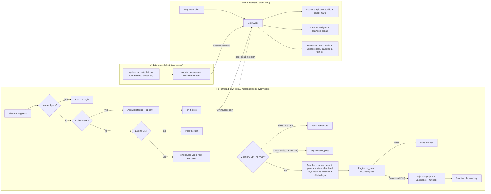
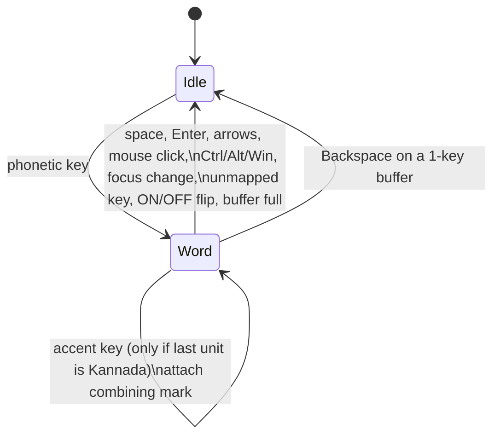

# Architecture

## Threads and data flow



## Engine pipeline (pure, `engine.rs`)

```
key ──► buf (roman word) ──► render(buf) ──► new Unicode
                                   │
              shown (on screen) ───┴──► diff by common code-point prefix
                                              │
                                  Edit { backspaces, text } ──► injector
```

`render` is a greedy longest-match tokenizer (`mapping.rs`) with a tiny state
machine:

```
 consonant ──► cluster + ್            (pending virama)
 vowel     ──► pending? replace ್ by matra (or drop it for 'a') : independent vowel
 M / H     ──► bare consonant: drop pending ್, append ಂ / ಃ   (kM = ಕಂ, full letter)
               after a break key: keep ್, append ಂ / ಃ         (k`M = ಕ್ಂ, half letter)
               g`M with Vedic mode on: ga + ್ replaced by U+A8F3
 accent    ──► (Vedic mode only) attachable? drop pending ್, append mark : literal char
 `         ──► break (no output; next vowel independent; a repeated ` is ignored)
 unknown   ──► literal (partial tokens such as "R" until "RRi" completes)
```

## Typing-buffer state diagram



## Vedic accent attachment

Accents are appended after the last emitted code point of the current unit:

```
ಕ + ್ + ಷ + ೇ  + U+0951      kShE'   (accent after the vowel sign of a conjunct)
ಅ ಗ ್ ನ ಿ    + U+0951      agni'
ಕ            + U+0951      k'      (no vowel typed: inherent a implied, virama dropped)
ಕ            + U+1CDA      ka^^    (second ^ replaces the U+0951 shown by the first)
```

Because the whole buffer is re-rendered on every key, an accent never corrupts
the buffer: later letters simply continue after it (`a'ka` → ಅ॑ಕ). The buffer is
**not** flushed by an accent or by `M`/`H`: Backspace removes just that key.

### Canonical output order

```
base consonant → matra → anusvara / visarga → Vedic marks (ascending combining class)
  ಕ              ಿ        ಂ                    ॒ (U+0952, ccc 220) then ॑ (U+0951, ccc 230)
```

`ka'M` and `kaM'` both render `ಕ ಂ ॑`: when `M` arrives after an accent the
renderer inserts it *before* the trailing marks (one backspace + retype on screen),
and `sort_trailing_marks` orders stacked marks by class. The result is already
NFC/NFD-stable. Rationale (spacing anusvara vs. non-spacing accents) is in the
header comment of `src/engine.rs`.

### Windows loop guard

```
SendInput(our edit) ──► WH_KEYBOARD_LL ──► is_injected(flags, extra)?  (hook/filter.rs)
                                             yes → CallNextHookEx, engine untouched
                                             no  → engine
```

## Known cross-application fragility

* **Backspace granularity.** The engine erases by *code point*. Most Win32,
  Chromium and GTK fields do the same for Kannada; a few (some rich editors)
  delete whole grapheme clusters, which would over-delete. If you hit one, use
  `--inject clipboard` for that session or file the app as an exception.
* **Synthetic Unicode.** Apps that read raw scan codes (some games, remote
  desktop clients, certain terminals) ignore `KEYEVENTF_UNICODE`.
* **UIPI.** Elevated windows ignore a non-elevated hook.
